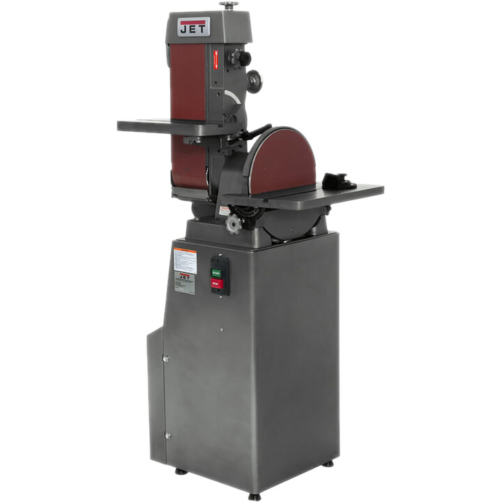
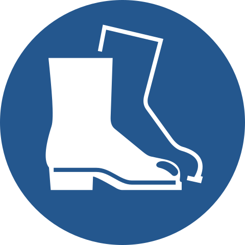

# Belt Sander

{ align="right" width="200px" }

## About

A sander is a powerful tool used to lightly grind, shape, or finish woods, metals, and other hard materials. It can be used for removing excess material, smoothing edges, or sharpening tools. Common types include disc and belt sanders.

## Setup

- Ensure the belt and disc are not damaged and properly mounted.
- Consider keeping an open container of water nearby to cool the part once finished.

## Usage

- Power on the sander and allow the disc or belt to reach full speed before use.
- Gently bring the workpiece to the sander. Do not force or press too hard; let the sander do the work.
- Keep consistent pressure, allowing the sander to remove material gradually.
- Be cautious of overheating, especially when sanding metal, as it can warp or damage the material. Cool the workpiece with water if needed.

## Cleanup

- Wait for the sander to stop fully.
- Sweep or vacuum any dust and metal shavings.

## Troubleshooting

| Issue | Action |
| ----- | ------ |
| Sander stalls or binds | Apply less pressure. Power off the sander and ensure the belt and disc are not obstructed or bound. |
| Overheating | Reduce pressure on the workpiece or cool periodically with water. Check that the belt is not excessively worn and replace if so. |
| Does not remove material | Ensure the belt is not excessively worn and replace if so. |

## Safety Guidelines

| Symbol | Description |
| ------ | ----------- |
| { width="40px" } | Closed-Toe Shoes   **Required** |
| { width="40px" } | Eye Protection   **Required** |
| { width="40px" } | Hearing Protection   **As Needed** |
| { width="40px" } | Tie Back Long Hair / Loose Clothes   **Required** |

- Material must be stable and held firmly. Rest the workpiece against the table when operating.
- Confirm that the belt and disc are undamaged and appropriate for the material.
- Keep hands and body clear of the belt and disc while the machine is in use.
- Wait for the belt to stop completely.
- Unplug the machine when changing the belt or disc.
