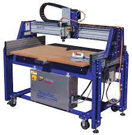

# CNC Router

{ align="right" width="250px" }

## About

A CNC router is a fast, automated machining tool used to cut, drill, and shape materials based on programmed instructions. Our ShopBot Buddy PRS (2ft x 4ft) features a stationary gantry and a moving table. While primarily used for wood, foam, and plastics, it is also capable of machining aluminum when configured with the correct tools, feeds, and speeds.

!!! note
    This page is meant as a quick reference for those already trained on our ShopBot Buddy PRS. If this is your first time, work through a tutorial with the guidance of someone who is trained.

    - [ShopBot Plate Tutorial Part 1](../tutorials/shopbot_plate_tutorial_part1.md)
    - [ShopBot Plate Tutorial Part 2](../tutorials/shopbot_plate_tutorial_part2.md)

## Setup

- Choose the correct router bit (e.g., straight, up-cut, down-cut, or compression) for your material.
- Secure the bit in the spindle/router chuck using the appropriate collet and wrenches.
    - Make sure the bit is inserted far enough into the collet (typically up to the line or leaving a small shank gap) and tightened securely.
- Power on the router electronics panel (large yellow/red switch on box under the router table).
- Secure the workpiece to the moving bed (spoilboard) using screws.
    - Ensure the fasteners will not interfere with the toolpath of the spindle.
- Set the X and Y zero points using the proxy switches (command `C3`) or manual alignment.
- Set the Z zero point on top of the material using the Z-zero contact plate (command `C2`):
    - Remember to place the alligator clip on the spindle and the plate under the bit before running the zeroing script, and return them to their holders afterward!
    - **Tip:** Test the connection before running the routine by touching the plate to the bit and ensuring **Input 1** lights up in the software.
- Load your ShopBot Part File (`.sbp`) into the ShopBot 3 control software:
    - Post-process your Fusion design using the ShopBot post-processor to generate the `.sbp` file.
    - Copy the file onto the router PC.
    - Simulate the toolpath in Fusion or verify it in the ShopBot software preview to detect potential errors.
- Every 4+ hours of non-use, the spindle must be dry-run to warm up internal bearings. Select the "spindle warmup routine" from the `Cuts` menu. This takes about 10 minutes.

## Usage

- Run through the setup steps above.
- Turn on the dust collector/vacuum.
- Press the green start button on the control pendant/software to initiate the cutting program.
- Monitor the machine closely during the initial cuts. Keep your hand near the emergency stop button.
- Monitor chip creation. Adjust feed rate override in the software if the machine is chattering or rubbing.

## Cleanup

- Remove your workpiece and any screws or tape from the spoilboard.
- Use the dust collector hose or a shop vac to clear all wood dust, chips, and shavings from the bed, gantry, and rails.
- Remove the router bit, clean it of any residue, and return it to its storage container.
- Wipe down the machine rails and keep the workspace tidy for the next user.

## Troubleshooting

| Issue | Action |
| ----- | ------ |
| Bit slipping or moving in Z | Ensure the collet is clean and the nut is properly tightened. Do not use worn-out collets. |
| Burn marks on wood | Spindle speed (RPM) is too high or feed rate is too slow. Increase feed rate or lower RPM. |
| Melting plastic | Use a single-flute or O-flute bit. Lower spindle RPM and increase feed rate to create clean chips instead of melting. |
| Spindle won't start | Ensure the control box is powered on, the emergency stop is released, and the spindle switch/key is engaged. |
| Z-zero routine fails or sparks | Check that the alligator clip is securely attached to the spindle shaft/collet and that the Z-plate cable is connected. Test the connection by touching the plate to the bit and verifying **Input 1** lights up in the software. |

## Safety Guidelines

| Symbol | Description |
| ------ | ----------- |
| { width="40px" } | Closed-Toe Shoes   **Required** |
| { width="40px" } | Eye Protection   **Required** |
| { width="40px" } | Hearing Protection   **Required** |
| { width="40px" } | Tie Back Long Hair / Loose Clothes   **Required** |
| { width="40px" } | **Do NOT**   Wear Gloves! |

- **Always run the dust collector** when cutting wood, MDF, or plastics to prevent inhalation of fine particles.
- **Never leave the machine unattended** while it is running. CNC routers can quickly start fires if a bit gets stuck or rubs.
- **Keep hands clear** of the moving table and the gantry. The bed moves dynamically along the X-axis.
- **Ensure workpiece is securely fastened** to the spoilboard. Loose material can fly off or ruin the tool.
- **Verify toolpath clearances** to avoid running the spindle or gantry into hold-down clamps or screws.
